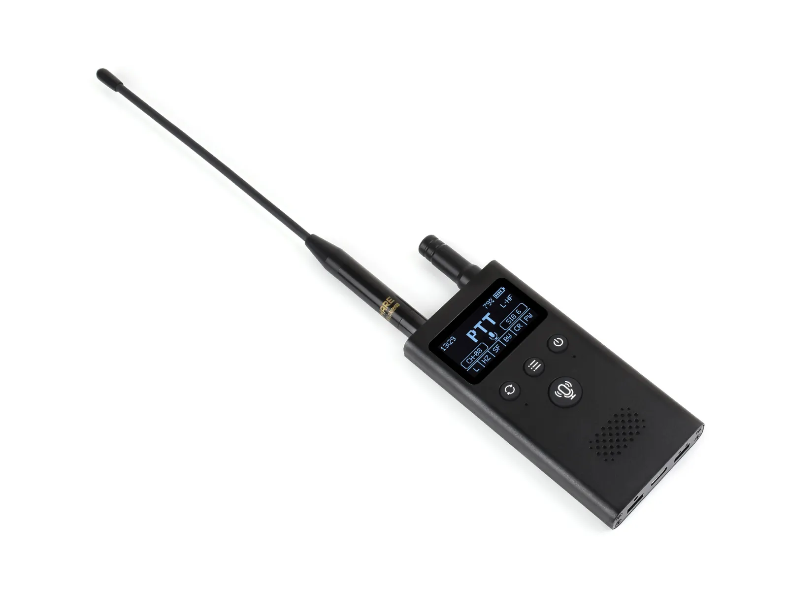

# Waveshare ESP32-S3-LR1121-OLED-1.54-XF

[English](README.md)

ESP32-S3-LR1121-OLED-1.54-XF 是一款面向 LoRa 无线通信和音频应用的开发板，基于 ESP32-S3R8，搭载最高 240 MHz 的双核 Xtensa LX7 处理器、8 MB 八线 PSRAM 和 16 MB Flash，支持 2.4 GHz Wi-Fi 与低功耗蓝牙。板载 LR1121 射频模块、1.54 英寸 128 × 64 单色 OLED、ES8311 扬声器编解码器、ES7210 麦克风 ADC、RTC、microSD 卡槽和电池接口，适用于无线传感与语音应用。

- [示例文档](docs/examples.md)
- [硬件参考](docs/hardware.md)
- [固件与出厂恢复](firmware/README.md)

## 概览

本仓库包含 Waveshare ESP32-S3-LR1121-OLED-1.54-XF 的第一方 ESP-IDF 和 Arduino 示例、工厂演示源码、原始出厂恢复固件、Arduino 捆绑库、原理图及机械尺寸文件。

显示屏采用 SSD1309 控制器，通过 I2C 通信，无触摸功能。板载外设还包括 PCF85063A RTC、BQ27220 电量计和单线 SDMMC 接口。共用数字引脚记录在[硬件参考](docs/hardware.md)中；使用无线功能前，请根据实物确认 HF/LF 射频模块及适用区域的射频参数。

## 快速开始

选择开发框架，并查看对应示例目录中的 README：

- ESP-IDF 项目：[`examples/esp-idf/`](examples/esp-idf/)
- Arduino 草图：[`examples/arduino/`](examples/arduino/)
- Arduino 捆绑库：[`libraries/`](libraries/)
- 工厂演示源码与恢复固件：[`firmware/`](firmware/)

ESP-IDF 项目使用各自的 `sdkconfig.defaults`，通过组件注册表在线下载 `waveshare/waveshare_boards` 的最新兼容版本。产品 C/H 适配代码位于 `components/esp32_s3_lr1121_oled_1_54_support`。当前配置的框架版本为 ESP-IDF **v5.5.5 / v6.1** 和 Arduino-ESP32 **3.3.12**，另外固定 **ESP-IDF 6.2 开发版**作为全部 IDF 项目的兼容性目标。LVGL 显示示例使用 **LVGL 9.5.0**，其中 IDF 显示项目使用 **LVGL Adapter 0.7.0**。

**ESP-IDF 已接入在线产品板定义。** `examples/esp-idf/` 下 11 个示例从 `waveshare/waveshare_boards` 下载 `esp32_s3_lr1121_oled_1_54_xf`（已核验 0.1.2，依赖仍为 `*`），使用方法见[板配置生成与校验](docs/board-manager.md)。工厂演示源码仍保留本地板定义。Arduino 依赖（包括捆绑的 LVGL）继续保留。

首次构建 IDF 示例前，请完成 [Board Manager 配置](docs/board-manager.md#enable-bmgr-with-esp-idf-55-or-6x)：在当前 IDF 的 Python 环境安装扩展、解析依赖，再按`idf.py bmgr -b esp32_s3_lr1121_oled_1_54_xf` 命令选择板定义。IDF 5.5 也通过该扩展提供 `bmgr` 命令。

Arduino 使用 **ESP32S3 Dev Module** 配置，选择 16 MB Flash、OPI PSRAM、`app3M_fat9M_16MB` 分区方案和硬件 USB CDC/JTAG。准确 FQBN 及版本配置见 [`config/frameworks.json`](config/frameworks.json)。Arduino OLED 示例使用 Arduino_GFX；Board Manager 和 LVGL Adapter 仅用于 ESP-IDF 项目。

环境准备和构建命令见[示例与构建说明](docs/examples.md)，其中也介绍了如何保留已有 SDK 配置和构建目录。

## 示例

| ESP-IDF 项目 | 功能 |
| --- | --- |
| [01_i2c_scan](examples/esp-idf/01_i2c_scan/) | 共用 I2C 总线扫描与寄存器操作控制台 |
| [02_sd_mmc](examples/esp-idf/02_sd_mmc/) | 单线 SDMMC 文件读写 |
| [03_button](examples/esp-idf/03_button/) | 板载按键事件 |
| [04_microphone](examples/esp-idf/04_microphone/) | ES7210 麦克风采集 |
| [05_speaker](examples/esp-idf/05_speaker/) | ES8311 扬声器播放 |
| [06_rtc_pcf85063](examples/esp-idf/06_rtc_pcf85063/) | 实时时钟与闹钟 |
| [07_bat_bq27220](examples/esp-idf/07_bat_bq27220/) | 电池状态测量 |
| [08_oled_ssd1309](examples/esp-idf/08_oled_ssd1309/) | LVGL 9 单色 OLED 界面，与 Arduino 示例一致 |
| [09_lora_ping_pong](examples/esp-idf/09_lora_ping_pong/) | LR1121 点对点无线收发 |
| [10_walkie_talkie](examples/esp-idf/10_walkie_talkie/) | 带 LVGL 界面的音频对讲应用 |
| [11_lorawan_starter](examples/esp-idf/11_lorawan_starter/) | LoRaWAN 入网与状态保存 |

| Arduino 草图 | 功能 |
| --- | --- |
| [01_i2c_scan](examples/arduino/01_i2c_scan/) | 共用 I2C 总线扫描 |
| [02_sd_mmc](examples/arduino/02_sd_mmc/) | 单线 SDMMC 文件读写 |
| [03_button](examples/arduino/03_button/) | 板载按键事件 |
| [04_microphone](examples/arduino/04_microphone/) | ES7210 麦克风采集 |
| [05_speaker](examples/arduino/05_speaker/) | ES8311 扬声器播放 |
| [06_rtc_pcf85063](examples/arduino/06_rtc_pcf85063/) | 实时时钟与闹钟 |
| [07_bat_bq27220](examples/arduino/07_bat_bq27220/) | 电池状态测量 |
| [08_oled_ssd1309](examples/arduino/08_oled_ssd1309/) | LVGL 9 单色 OLED 界面 |
| [09_lora_ping_pong](examples/arduino/09_lora_ping_pong/) | LR1121 点对点无线收发 |
| [10_walkie_talkie](examples/arduino/10_walkie_talkie/) | 带 Arduino_GFX 界面的音频对讲应用 |
| [11_lorawan_starter](examples/arduino/11_lorawan_starter/) | LoRaWAN 入网与状态保存 |

[12_factory_demo](firmware/12_factory_demo/) 是额外的 ESP-IDF 源码项目，保留工厂演示的差异功能和 LVGL 界面，共用相同板定义 YAML，并纳入源码构建矩阵。

第一方 Arduino 草图直接位于 `examples/arduino/` 下，目录名与 `.ino` 文件名一致。捆绑库内部示例、备份和下载组件不参与产品 CI。原始工厂二进制与源码构建产物分开保存。

## 持续集成

工作流自动发现项目，手动运行时可选择 `all`、示例名称或仓库相对路径。当前配置的矩阵包含**36 个 ESP-IDF 构建任务**（两个稳定版本共 24 个，加上固定的 6.2 开发版 12 个），以及 **11 个 Arduino 构建任务**。开发版任务单独标注，详见 [ESP-IDF 6.2 兼容说明](docs/idf-6.2.md)。

源码构建成功后会打包为可烧录压缩包，包含清单、校验和、烧录参数及 Windows/POSIX 烧录脚本。IDF 包包含原始分段和合并镜像；Arduino 包使用内核导出的合并镜像。分支构建上传 Actions 产物；`v主版本.次版本.修订版本` 标签触发 Release 流程，全部检查及 47 个固件包通过校验后才会发布。具体见[发布说明](releases/README.md)。

板定义缺失仍阻塞两项音频测试、仓库校验和完整固件 Release。首次 GitHub 构建已生成 10 个 Arduino 固件包；本次修复了 OLED 配置头发现失败和 ESP-IDF 工作流表达式错误，需由新的 CI 运行验证，不代表全部 IDF 示例已构建通过。具体见[CI 与验证记录](docs/validation.md)和[源码固件打包说明](releases/README.md)。

## 仓库结构

| 路径 | 用途 |
| --- | --- |
| `examples/esp-idf/` | 第一方 ESP-IDF 示例 |
| 各 IDF 项目的 `components/` | C/H 适配代码位于 `esp32_s3_lr1121_oled_1_54_support`；官方板包自动下载；示例的板定义接入待完成 |
| `examples/arduino/` | 第一方 Arduino 草图 |
| `libraries/` | Arduino 第三方捆绑依赖，包含 LVGL 9.5.0 |
| `config/` | 框架版本、板选项和 Arduino LVGL 配置 |
| `scripts/` | 示例发现、盘点、验证和构建辅助工具 |
| `tests/` | 示例发现与固件打包单元测试 |
| `releases/` | 源码固件打包工具与说明 |
| `firmware/` | 工厂演示源码与原始恢复二进制 |
| `hardware/` | 原理图与机械尺寸文件 |
| `docs/` | 硬件、框架、组件和验证说明 |

## 文档

- [示例与构建说明](docs/examples.md)
- [硬件参考](docs/hardware.md)
- [框架与组件版本](docs/versions.md)
- [ESP-IDF 6.2 兼容说明](docs/idf-6.2.md)
- [Board Manager 接入说明](docs/board-manager.md)
- [CI 与验证记录](docs/validation.md)
- [固件与出厂恢复](firmware/README.md)
- [源码固件打包说明](releases/README.md)
- [贡献指南](CONTRIBUTING.md)
- [技术支持](SUPPORT.md)
- [安全政策](SECURITY.md)

## 许可证

仓库自有代码采用 Apache License 2.0，详见 [LICENSE](LICENSE)。第三方库和生成源码保留各自的许可证声明。
